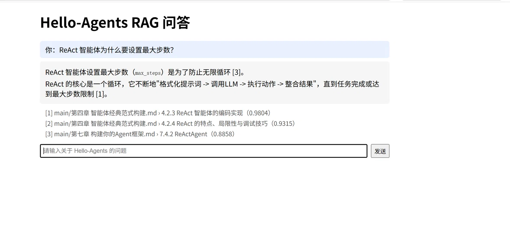
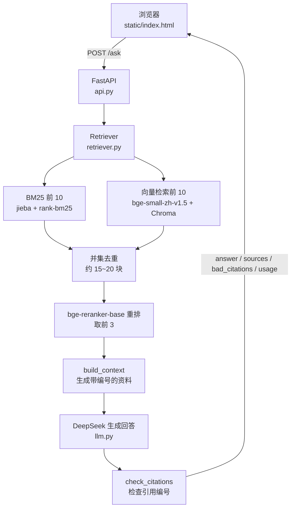
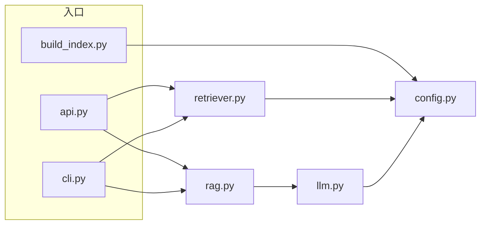

# ai-agent-learning

> 我学习 AI Agent / 大模型应用开发的记录仓库：每周一篇技术总结和对应的练习代码。

## 📖 项目简介

这个仓库记录我按 **16 周计划**（2026.09.01 – 2026.12.21）从零学习 AI Agent / 大模型应用开发的过程。起点是只会 Python 基础语法，目标是产出 3 个能写进简历的项目，并具备应用开发方向实习的面试能力。

- 每周一篇技术总结（根目录的 `weekN-*.md`），重点记录**自己踩过的坑**和**实测数据**
- 每周的练习代码放在对应的 `weekN/` 文件夹
- 项目一（RAG 问答）的独立应用放在 [`rag_app/`](rag_app/)

**关注的研究方向：记忆冲突与时间一致性。** 第 5、6 周的笔记里提出过这个问题：RAG 默认"检索回来的资料都是对的"，但当几块资料**互相矛盾，或者有新有旧**时，模型会怎么选？这是后面想继续研究的问题。

## 🗺️ 学习路线

状态说明：✅ 已完成 · 🚧 进行中 · ⬜ 未开始 · ❔ 待定

"实际完成"一列取自 git 提交记录。实际进度比计划晚一些，以下按实际情况标注。

| 周 | 计划时间 | 主题 | 状态 | 实际完成 | 笔记 | 代码 |
|---|---|---|---|---|---|---|
| **阶段一：工程地基** | | | | | | |
| 1 | 9/1 – 9/7 | Python 进阶（类、类型注解、异常、标准库、环境管理） | ✅ | 9/5 – 9/7 | [笔记](week1-python-basics.md) | [week1/](week1/) |
| 2 | 9/8 – 9/14 | Git + HTTP + 异步 | ✅ | 9/7 | [笔记](week2-git-http-async.md) | [week2/](week2/) |
| 3 | 9/15 – 9/21 | FastAPI + SSE + Docker + Linux | ✅ | 9/23 | [笔记](week3-fastapi-docker.md) | [week3/](week3/) |
| **阶段二：LLM 基础** | | | | | | |
| 4 | 9/22 – 9/28 | 裸调 LLM API 与 Prompt 工程 | ✅ | 10/12 – 10/14 | [笔记](week4-llm-api-prompt.md) | [week4/](week4/) |
| 5 | 9/29 – 10/5 | Function Calling 与 Agent 循环 | ✅ | 10/21 – 10/24 | [笔记](week5-function-calling.md) | [week5/](week5/) |
| **阶段三：RAG + 项目一** | | | | | | |
| 6 | 10/6 – 10/12 | RAG 基础链路 | ✅ | 10/25 – 10/26 | [笔记](week6-rag-basics.md) | [week6/](week6/) |
| 7 | 10/13 – 10/19 | 检索优化与评测 | ✅ | 10/29 – 11/2 | [笔记](week7-retrieval-eval.md) | [week7/](week7/) |
| 8 | 10/20 – 10/26 | 项目一收尾上线（延迟优化、FastAPI 服务、聊天网页、Docker 打包） | ✅ | 11/4 – 11/8 | — | [week8/](week8/)、[rag_app/](rag_app/) |
| **阶段四：Agent 核心 + 项目二** | | | | | | |
| 9 | 10/27 – 11/2 | 手写 ReAct（不用框架） | ⬜ | | | |
| 10 | 11/3 – 11/9 | MCP 协议 | ⬜ | | | |
| 11 | 11/10 – 11/16 | Memory + 沙箱 + 可观测 | ⬜ | | | |
| 12 | 11/17 – 11/23 | 项目二收尾 | ⬜ | | | |
| **阶段五：多 Agent + 评测体系 + 项目三** | | | | | | |
| 13 | 11/24 – 11/30 | LangGraph | ⬜ | | | |
| 14 | 12/1 – 12/7 | 多 Agent 协作 | ⬜ | | | |
| 15 | 12/8 – 12/14 | 自动化评测平台（项目三） | ⬜ | | | |
| 16 | 12/15 – 12/21 | 简历打磨 + 面试冲刺 | ⬜ | | | |

## 📁 目录说明

| 路径 | 内容 |
|---|---|
| [`week1-python-basics.md`](week1-python-basics.md) | 第 1 周总结：类与对象、类型注解、异常处理、pathlib/json/logging、环境管理、典型错误合集 |
| [`week1/`](week1/) | 对话类、`.env` 读取、json/pathlib 练习、Token 计数器、工具注册表 `ToolRegistry` |
| [`week2-git-http-async.md`](week2-git-http-async.md) | 第 2 周总结：Git 三区模型、远程协作、HTTP 基础、httpx、async/await |
| [`week2/`](week2/) | httpx 实战练习、async/await 实验 |
| [`week3-fastapi-docker.md`](week3-fastapi-docker.md) | 第 3 周总结：FastAPI、Pydantic、SSE 流式返回、Docker、Linux 命令行 |
| [`week3/`](week3/) | FastAPI 服务（`POST /chat/stream` SSE 接口）、数据模型、生成器演示、测试客户端 |
| [`week4-llm-api-prompt.md`](week4-llm-api-prompt.md) | 第 4 周总结：DeepSeek API、Token 与计费、流式输出、多轮对话、Prompt 工程、JSON Mode |
| [`week4/`](week4/) | 第一次调用、流式调用（TTFT 统计）、多轮对话、JSON 信息抽取 |
| [`week5-function-calling.md`](week5-function-calling.md) | 第 5 周总结：Function Calling 五步流程、工具描述消融实验、多轮 Agent 循环、并行调用、错误回填 |
| [`week5/`](week5/) | Function Calling 循环、工具描述消融实验、Agent 循环 |
| [`week6-rag-basics.md`](week6-rag-basics.md) | 第 6 周总结：Embedding、切块、Chroma、向量检索、出处标注、混合检索 |
| [`week6/`](week6/) | Embedding 演示、Markdown 切块器、建库、语义检索、带引用的 RAG |
| [`week7-retrieval-eval.md`](week7-retrieval-eval.md) | 第 7 周总结：评测集、Hit@K / MRR、BM25、RRF、bge-reranker 重排、bad case 分析 |
| [`week7/`](week7/) | Hello-Agents 语料清洗与切块、评测集生成、检索评测、混合检索与重排 |
| [`week8/`](week8/) | 重排延迟实验（候选池大小 × `max_length` 四组配置对比） |
| [`rag_app/`](rag_app/) | 项目一：独立的 RAG 问答应用（配置、切块、建库、`Retriever` 类、LLM 调用、命令行问答、FastAPI 服务、聊天网页、Dockerfile） |
| [`common/`](common/) | 各周共用模块：`CostTracker` 计费器（区分缓存命中计价） |
| [`Dockerfile`](Dockerfile) | 第 3 周 FastAPI 服务的示例镜像（只打包 `week3/`，和项目一无关；项目一的镜像见 [`rag_app/Dockerfile`](rag_app/Dockerfile)） |
| [`requirements.txt`](requirements.txt) | Python 依赖 |
| [`.env.example`](.env.example) | 环境变量模板（API Key 只放在本地 `.env`，不提交） |
| [`assets/`](assets/) | README 用的截图 |

## 🚀 项目展示

### 项目一：Hello-Agents RAG 问答系统（✅ 第 6~8 周完成）

代码：[`rag_app/`](rag_app/) · 过程记录：[第 6 周](week6-rag-basics.md)、[第 7 周](week7-retrieval-eval.md)、[`week8/`](week8/)

**状态**：第 6~8 周完成 RAG 问答系统，包括检索优化、评测、延迟优化、FastAPI 服务、聊天网页、Docker 打包。



#### 简介

- **语料**：Datawhale 开源教程 [Hello-Agents](https://github.com/datawhalechina/hello-agents) 中文版（正文 16 章 + 扩展 14 篇，共 30 篇），切成 **2505 块**
- **语料许可**：CC BY-NC-SA 4.0。原文和向量库**不提交到仓库**（`data/`、`chroma_db/` 在 [`.gitignore`](.gitignore) 中），需要自行下载语料并运行 `build_index.py` 建库
- **功能**：
  - 中文问答，回答带引用编号 `[1][2]`
  - 回答下方列出出处：`文件 › 小节标题`，以及重排分数
  - 检查回答里的引用编号是否真的存在（`bad_citations`）
  - 检索不到相关资料时承认不知道（回答"资料中没有相关内容"），不编造

#### 架构



**模块依赖单向**：入口（`api.py`、`cli.py`、`build_index.py`）→ `rag.py` / `retriever.py` → `llm.py` / `config.py`。



模型（向量模型、重排模型）和 BM25 索引只在服务启动时（FastAPI `lifespan`）加载一次，之后所有请求共用同一个 `Retriever`。

`rag_app/` 文件结构：

```
rag_app/
├── config.py                  全部配置；会随部署环境变化的值可用 RAG_ 前缀的环境变量覆盖
├── chunker.py                 语料清洗与切块
├── build_index.py             建库：切块 → 算向量 → 存进 Chroma
├── retriever.py               Retriever 类：BM25 + 语义并集召回 → reranker 重排
├── llm.py                     调用 DeepSeek（重试、返回 usage）
├── rag.py                     RAG 流程：检索 → build_context → 生成 → check_citations
├── api.py                     FastAPI 服务：GET /、GET /health、POST /ask
├── cli.py                     命令行问答
├── static/index.html          聊天网页
├── download_models.py         Docker build 时下载两个模型
├── requirements.txt           Docker 镜像用的依赖（torch 在 Dockerfile 里单独装 CPU 版）
├── Dockerfile                 项目一镜像
└── Dockerfile.dockerignore    只对 rag_app/Dockerfile 生效（排除 .env、data/ 等）
```

#### 技术选型与理由

| 环节 | 选型 | 理由 |
|---|---|---|
| 向量模型 | bge-small-zh-v1.5 | 中文、体积小、CPU 可跑 |
| 关键词检索 | BM25（jieba 分词 + rank-bm25） | 语料里有大量代码和专有名词，语义检索对这类查询召回差 |
| 召回与排序 | 并集召回 + bge-reranker-base 两阶段重排 | 混合检索负责"多找到"，重排负责"排对顺序" |
| 未采用 | RRF 融合 | 实测在本数据上 RRF 怎么调权重都不如单路 BM25（语义一路明显更弱） |
| 向量库 | Chroma | 本地零配置向量库 |
| 大模型 | DeepSeek（`deepseek-flash`） | 便宜、国内可用 |
| 服务与前端 | FastAPI + 原生 HTML/JS（marked 渲染 Markdown + DOMPurify 防 XSS） | 同源部署，无需 CORS |
| 部署 | Docker | CPU 版 torch；模型在 build 时下载进镜像，运行时离线加载 |

#### 评测（第 7 周）

自建检索评测集 **123 题**：用 DeepSeek 分层抽样出题 + 人工复核，分成 **dev 91 题**（用来选方案）和 **test 32 题**（只用来做最终验证）。指标为 Hit@K、MRR，两种口径一起报：

- **严格**：检索到的块必须包含标注的原文句子
- **同节**：和标注同文件、同小节的块也算命中

> ⚠️ test 集只有 32 题，1 题约 3.1 个百分点，比较时应看方法之间的差距，不看绝对值。

**test 集（32 题）结果**：

| 方法 | 严格 Hit@3 | 严格 MRR | 同节 Hit@3 | 同节 MRR | 平均每题检索耗时 |
|---|---|---|---|---|---|
| 纯语义检索（基线） | 59.4% | 51.3% | 65.6% | 63.5% | 0.01 秒 |
| BM25 | 75.0% | 68.8% | 78.1% | 77.6% | 0.01 秒 |
| **并集召回 + 重排**（pool=20, max_length=512） | **87.5%** | **82.1%** | **90.6%** | **86.6%** | 10.40 秒 |

**dev 集（91 题）各方法对比**（严格命中，第 7 周选方案时用）：

| 方法 | Hit@1 | Hit@3 | Hit@5 | Hit@10 | MRR |
|---|---|---|---|---|---|
| 语义检索（基线） | 31.9% | 49.5% | 59.3% | 70.3% | 43.1% |
| BM25 | 57.1% | 76.9% | 79.1% | 87.9% | 68.0% |
| RRF 1:1 | 46.2% | 71.4% | 75.8% | 86.8% | 59.9% |
| RRF 1:3 | 53.8% | 71.4% | 76.9% | 85.7% | 65.0% |
| **并集召回 + 重排** | **75.8%** | **85.7%** | **92.3%** | **94.5%** | **82.5%** |

> 实测：RRF 融合在这份数据上不如单路 BM25，最终方案没有用 RRF。

#### 延迟优化（第 8 周）

分段计时：召回 **0.066 秒**，重排 **7.11 秒（占 99%）**，所以只优化重排。在 dev 集（91 题）上比较候选池大小（`pool`，每路取几块）× reranker `max_length` 的 4 种配置（代码：[`week8/latency_exp.py`](week8/latency_exp.py)）：

| 配置 | pool | max_length | 严格 Hit@3 / MRR | 同节 Hit@3 / MRR | 平均耗时 |
|---|---|---|---|---|---|
| A | 20 | 512 | 85.7 / 82.5 | 93.4 / 88.7 | 8.33 秒 |
| B | 10 | 512 | 84.6 / 81.4 | 92.3 / 88.5 | 4.76 秒 |
| C | 20 | 256 | 84.6 / 80.5 | 92.3 / 88.3 | 5.53 秒 |
| **D** | **10** | **256** | **83.5 / 79.4** | **92.3 / 87.6** | **2.86 秒** |

**选择 D**：比 A 快 2.9 倍，dev 上只少答对 2 题。决策依据是 dev 集。

D 在 test 集上：严格 Hit@3 81.2% / MRR 74.7%，同节 84.4% / 81.1%，平均 3.94 秒（A 为 87.5 / 82.1、10.40 秒，差 2 题）。

> 如实说明：test 集到这里已经使用了 2 次，以后不再用于调参。

需要更高准确率（例如有 GPU）时，可以通过环境变量切回 A：

```bash
RAG_POOL=20
RAG_RERANK_MAX_LEN=512
```

其他可覆盖的配置（`RAG_TOP_K`、`RAG_LLM_MODEL`、`RAG_CORPUS_DIR`、`RAG_DB_DIR`）见 [`rag_app/config.py`](rag_app/config.py)。

#### API 用法

| 接口 | 说明 |
|---|---|
| `GET /` | 聊天页面（浏览器打开 http://127.0.0.1:8000/ ） |
| `GET /docs` | FastAPI 自动生成的接口文档 |
| `GET /health` | 返回 `{"status": "ok"}`；模型未加载完时为 `{"status": "loading"}` |
| `POST /ask` | 提问，见下 |

**`POST /ask`**

请求（`question` 长度 1~500 字）：

```json
{"question": "什么是 ReAct？"}
```

响应：

```json
{
  "answer": "……[1]……[2]",
  "sources": [
    {"source": "文件名", "heading": "小节标题", "score": 0.9876}
  ],
  "bad_citations": [],
  "usage": {"prompt_tokens": 0, "completion_tokens": 0, "total_tokens": 0}
}
```

- `sources`：交给大模型的资料，顺序和回答里的编号一一对应（`[1]` 是第 1 条）；`score` 是重排分数
- `bad_citations`：回答里出现、但不在 1~N 范围内的引用编号，正常情况下为空列表
- `usage`：DeepSeek 原样返回的 token 用量（上面的字段只是示意）

错误码：

| 状态码 | 含义 |
|---|---|
| 422 | 参数校验失败（例如 `question` 为空或超过 500 字） |
| 502 | 大模型调用失败（网络重试 3 次仍失败，或 DeepSeek 返回非 200） |
| 500 | 服务内部错误 |

**调用示例**

Linux / macOS：

```bash
curl -X POST http://127.0.0.1:8000/ask -H "Content-Type: application/json" -d '{"question": "什么是 ReAct？"}'
```

Windows PowerShell：

```powershell
Invoke-RestMethod -Uri http://127.0.0.1:8000/ask -Method Post -ContentType "application/json; charset=utf-8" -Body ([System.Text.Encoding]::UTF8.GetBytes('{"question": "什么是 ReAct？"}'))
```

Python（httpx）：

```python
import httpx

r = httpx.post("http://127.0.0.1:8000/ask", json={"question": "什么是 ReAct？"}, timeout=60)
r.raise_for_status()
data = r.json()
print(data["answer"])
for i, s in enumerate(data["sources"], 1):
    print(f"[{i}] {s['source']} › {s['heading']}（{s['score']:.4f}）")
```

#### 如何运行

**本地运行**（在项目根目录执行）：

1. 创建虚拟环境并安装依赖

   ```bash
   python -m venv .venv
   ```

   ```bash
   source .venv/bin/activate
   ```

   （Windows：`.venv\Scripts\activate`）

   ```bash
   pip install torch
   ```

   ```bash
   pip install -r rag_app/requirements.txt
   ```

2. 准备语料：从 [Hello-Agents](https://github.com/datawhalechina/hello-agents) 下载中文版 Markdown 文件，放到 `data/hello-agents-zh/`（`build_index.py` 会递归读取其中所有 `*.md`）

3. 在项目根目录新建 `.env`，写入 DeepSeek Key（变量名以 [`rag_app/llm.py`](rag_app/llm.py) 为准）：

   ```
   DEEPSEEK_API_KEY=你的DeepSeek密钥
   ```

   > `.env` 已在 `.gitignore` 中，不要提交；值不要加引号。

4. 建库（语料或切块规则改了才需要重新运行；第一次运行前请先看下面关于模型下载的说明）：

   ```bash
   python -m rag_app.build_index
   ```

5. 启动服务，然后浏览器打开 http://127.0.0.1:8000/ ：

   ```bash
   uvicorn rag_app.api:app
   ```

   也可以用命令行问答：

   ```bash
   python -m rag_app.cli
   ```

> 模型默认离线加载（`config.py` 中 `HF_HUB_OFFLINE=1`），并使用 `hf-mirror.com` 镜像。本机还没有缓存模型时，第一次运行 `build_index` / 启动服务前需要临时设置环境变量 `HF_HUB_OFFLINE=0`，让程序联网下载两个模型。

**Docker 运行**（需要先在本地建好 `chroma_db/`，镜像会直接复制它，容器里不重新建库）：

```bash
docker build -f rag_app/Dockerfile -t rag-app .
```

```bash
docker run --rm --env-file .env -p 8000:8000 rag-app
```

- `.env` 不会进入镜像（被 [`rag_app/Dockerfile.dockerignore`](rag_app/Dockerfile.dockerignore) 排除），运行时用 `--env-file` 传入
- `.env` 中的值**不要加引号**：`--env-file` 不会去掉引号，引号会被当成 Key 的一部分
- 镜像压缩后 1.65 GB，解压后 4.94 GB
- 根目录的 [`Dockerfile`](Dockerfile) 是第 3 周的练习，和项目一无关

#### 已知局限与后续计划

- 目前只评测了检索，答案层准确率还未评测（计划用 LLM-as-a-Judge）
- 评测集每题只标一处正确答案，跨章节讲同一话题时会被误判
- test 集只有 32 题，误差较大
- 重排在 CPU 上仍需约 3~4 秒，尚未做流式输出
- 尚未部署到公网；公开部署前需要加限流

### 阶段性练习成果

| 周 | 成果 | 代码 |
|---|---|---|
| 3 | SSE 流式聊天接口：`POST /chat/stream` 逐字推送 JSON，末尾附 token 统计块；打包成 Docker 镜像 | [week3/](week3/)、[Dockerfile](Dockerfile) |
| 4 | 不用 SDK、用 httpx 直接调 DeepSeek；流式输出统计首 token 延迟（TTFT）；JSON Mode 信息抽取 | [week4/](week4/) |
| 5 | 工具描述消融实验：详细描述准确率 **100%**，模糊描述 **70%**（3 个困难负样本全部误调；样本量小，只作信号） | [week5/tool_ablation.py](week5/tool_ablation.py) |
| 5 | 多轮 Agent 循环：支持并行工具调用，工具出错时把报错回填给模型，不会崩溃 | [week5/agent_loop.py](week5/agent_loop.py) |
| 6 | 对 week1–5 笔记（591 块）做 RAG：语义检索 + 关键词检索，回答带出处并校验引用编号 | [week6/](week6/) |

## 🛠️ 技术栈

| 类别 | 技术 |
|---|---|
| 语言与工程 | Python、uv、python-dotenv、logging、Git |
| 网络与服务 | httpx、requests、asyncio、FastAPI、Pydantic、Uvicorn、SSE |
| 部署 | Docker |
| 大模型 | DeepSeek API（裸调 `/v1/chat/completions`，流式、多轮、JSON Mode、Function Calling） |
| RAG | sentence-transformers、bge-small-zh-v1.5（Embedding）、bge-reranker-base（重排）、Chroma、rank_bm25、jieba |
| 评测 | 自建评测集，Hit@K、MRR，dev / test 划分 |

## 🕒 最近更新

**2026-11-08**：项目一（Hello-Agents RAG 问答）完成：FastAPI 服务（`/health`、`/ask`）、聊天网页、Docker 打包；README 补充项目一完整介绍。

**2026-11-04**：`rag_app` 改为独立项目，集中管理配置，`Retriever` 类延迟加载模型，新增命令行问答。
